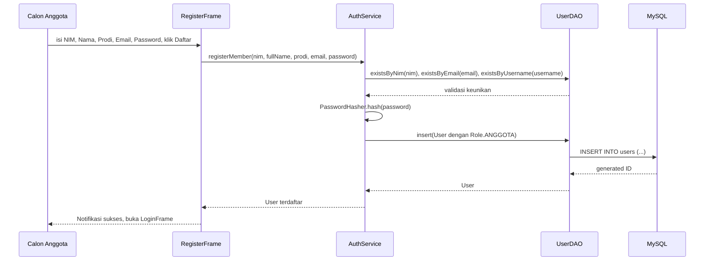
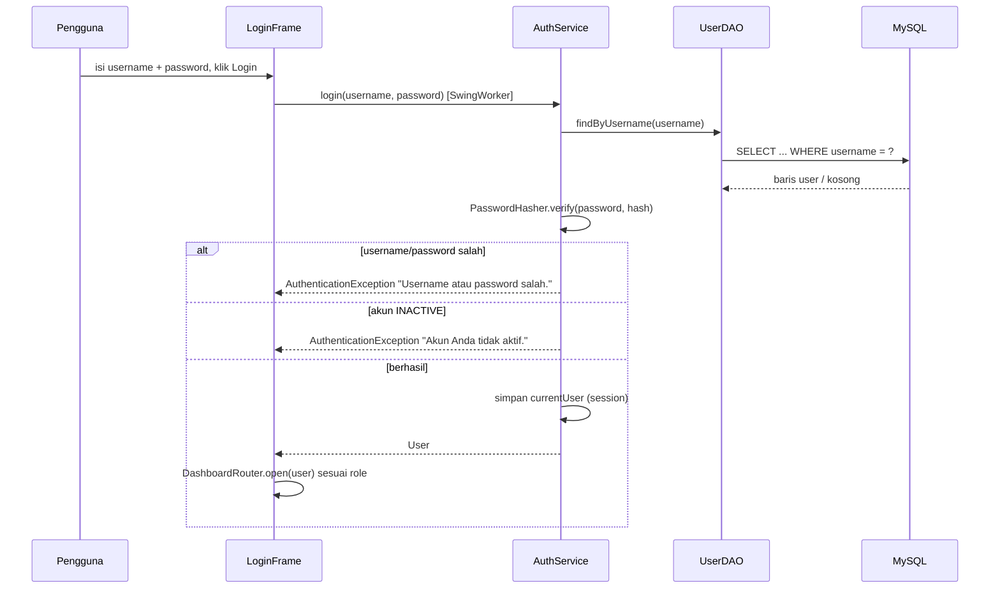

# Dokumentasi Alur Autentikasi — SmartLib (Anggota 2)

## 1. Komponen
| Lapisan | Class | Tugas |
|---|---|---|
| model | `User`, `Role`, `Permission` | Data akun, profil mahasiswa (NIM, Prodi, Email), role, dan pemetaan hak akses (RBAC) |
| dao | `UserDAO` | Query `users` + `roles` memakai `PreparedStatement` |
| service | `AuthService` | Login/logout, session, registrasi mandiri, kelola profil/password, pengecekan hak akses, manajemen akun |
| util | `PasswordHasher` | Hash PBKDF2-HMAC-SHA256 + salt acak |
| ui | `LoginFrame`, `RegisterFrame`, `ManageAccountFrame`, `DashboardRouter`, `UserManagementFrame` | Form login, registrasi mandiri anggota, kelola akun/profil saya, arah dashboard per role, kelola pengguna (Admin) |

## 2. Alur login & registrasi mandiri

Logout: `AuthService.logout()` mengosongkan `currentUser`, lalu `LoginFrame` ditampilkan lagi.

## 3. Fitur Kelola Akun Mandiri (`ManageAccountFrame`)
Setiap pengguna yang login (khususnya Anggota) dapat membuka menu **Kelola Akun Saya** pada dashboard:
1. **Informasi Profil**: Melihat Username, Role, Status, NIM, serta mengubah Nama Lengkap, Program Studi, dan Email.
2. **Ganti Password**: Memvalidasi password saat ini, memverifikasi kecocokan password baru (minimal 8 karakter), lalu mengupdate hash password baru di database.

## 4. Keamanan
- Password disimpan sebagai `pbkdf2$iterasi$salt$hash`, tidak pernah teks biasa.
- Pesan gagal sama untuk username salah dan password salah (tidak membocorkan keberadaan akun).
- Hak akses dicek di `AuthService.requirePermission()`, bukan hanya dengan menyembunyikan tombol.
- Admin tidak bisa menonaktifkan akunnya sendiri / admin aktif terakhir.
- Pengguna hanya dapat mengubah profil dan password miliknya sendiri saat sesi login aktif (`currentUser`).

## 5. Matriks hak akses (sesuai PRD bagian 6)
Didefinisikan di `Role.java`. Modul lain cukup memanggil, misalnya:
`AuthService.getInstance().requirePermission(Permission.PROCESS_LOAN);`

## 6. Skenario pengujian
| No | Skenario | Hasil diharapkan | Tes |
|---|---|---|---|
| 1 | Login admin/petugas/anggota benar | Masuk, role sesuai | `loginBerhasilSetiapRole` |
| 2 | Password salah | Ditolak, pesan umum | `passwordSalahDitolak` |
| 3 | Username tidak ada | Ditolak, pesan sama | `usernameTidakAdaPesannyaSamaDenganPasswordSalah` |
| 4 | Akun nonaktif | Ditolak | `akunNonaktifTidakBisaLogin` |
| 5 | Input kosong | Ditolak | `inputKosongDitolak` |
| 6 | Petugas/anggota buka kelola pengguna | `AccessDeniedException` | `petugasDanAnggotaTidakBolehKelolaPengguna` |
| 7 | Logout | Session kosong | `sessionTersimpanLaluHilangSetelahLogout` |
| 8 | Admin buat akun | Password tersimpan hash | `adminMembuatAkunDenganPasswordTerhash` |
| 9 | Registrasi mandiri anggota | Akun tersimpan dengan role ANGGOTA, NIM, Prodi, Email | `registrasiAnggotaMandiriBerhasil` |
| 10 | Registrasi NIM duplikat | Ditolak dengan pesan jelas | `registrasiAnggotaNimDuplikatDitolak` |
| 11 | Registrasi Email tidak valid / duplikat | Ditolak | `registrasiAnggotaEmailTidakValidAtauDuplikatDitolak` |
| 12 | Kelola akun: perbarui profil sendiri | Profil terupdate pada DB & currentUser | `kelolaAkunPerbaruiProfilSendiri` |
| 13 | Kelola akun: ganti password sukses & gagal verifikasi | Password lama salah ditolak, benar diupdate | `kelolaAkunGantiPassword` |

## 7. Cara menjalankan
1. Jalankan `sql/auth_schema.sql` di MySQL Workbench.
2. Sesuaikan user/password MySQL di `DatabaseConnection.java`.
3. Jalankan `Main.java`; tes otomatis: `mvn test`.
